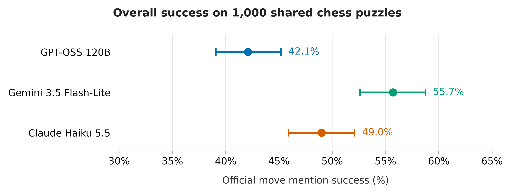

# Assisted one-move chess-puzzle success

Victor Le · DA401 · Final analysis completed November 1, 2026

I study how human-rated difficulty and board characteristics relate to LLM success on the same 1,000 chess puzzles. Each deployment receives FEN, a piece list and every legal move in alphabetical order, without the answer, rating, theme labels, engine evaluations or tools. The amended outcome counts the official solution move anywhere in the visible answer: **assisted solution-move mention success**, which does not require a unique recommendation.

## Final results

All three deployments completed 1,000 unique puzzles with the same frozen 800 training / 200 test split. Final checks verified saved collection audits, response IDs, puzzle metadata, split and hashes. Analysis made no new API calls.

| Deployment | Correct / puzzles | Tolerant success | Wilson 95% interval |
| --- | ---: | ---: | ---: |
| GPT-OSS 120B | 421 / 1,000 | 42.1% | 39.1%–45.2% |
| Gemini 3.5 Flash-Lite | 557 / 1,000 | 55.7% | 52.6%–58.8% |
| Claude Haiku 5.5 | 490 / 1,000 | 49.0% | 45.9%–52.1% |

The pooled logistic regression uses all 3,000 answers, frozen board features and deployment indicators, with standard errors clustered over 1,000 puzzles. A 500-point rating increase is associated with an odds ratio of **0.564** (95% CI 0.511–0.624; two-sided p=3.61×10⁻²⁹). These are adjusted associations, not causal effects. Secondary estimates and ordinary intervals are in the report.

Separate fixed XGBoost classifiers predict whether each deployment succeeds. Each uses 800 training puzzles, 150 trees, depth 3, learning rate 0.05 and fixed regularization. Native models were saved before evaluating on the 200 held-out puzzles; reruns reuse cached predictions. No test tuning or early stopping was used.

| Deployment | Held-out prediction accuracy | Balanced accuracy | ROC AUC | Brier | Majority baseline accuracy |
| --- | ---: | ---: | ---: | ---: | ---: |
| GPT-OSS 120B | 58.0% | 0.530 | 0.599 | 0.242 | 60.5% |
| Gemini 3.5 Flash-Lite | 70.0% | 0.690 | 0.714 | 0.214 | 56.0% |
| Claude Haiku 5.5 | 54.5% | 0.543 | 0.598 | 0.247 | 51.0% |

These measure **prediction of LLM success**, distinct from LLM puzzle-success rates. GPT-OSS prediction falls below its training-majority baseline; Gemini shows the clearest predictive performance. Small differences for the other deployments warrant caution.

Read the [final report](writing/final_report.md) for methods, regression estimates, rating-band results, scoring sensitivity and limitations. [Shareable CSV tables](writing/final_tables/) accompany it.

Other final figures: [rating-band success](figures/one_move_v1/final/rating_band_accuracy.png), [adjusted rating curves](figures/one_move_v1/final/logistic_regression.png), [XGBoost training importance](figures/one_move_v1/final/xgboost_feature_importance.png), and [held-out confusion matrices](figures/one_move_v1/final/heldout_confusion.png).

## Interpretation and amendments

Because **979/1,000 puzzles are tagged mate-in-one**, conclusions mainly concern short mating tactics under legal-move assistance. The rating-balanced sample does not represent all chess puzzles. Provider settings and effort labels differ; comparisons concern the recorded deployments rather than equal compute or isolated architecture effects.

The [scoring amendment](experiments/one_move_v1/scoring_amendment.md) followed inspection of strict results, including completed Gemini collection. It accepts a board-resolvable official move anywhere in the visible answer, including explanations, alternatives or negation. Original strict scores and immutable raw logs remain intact.

| Deployment | Strict success | Tolerant success | Answers mentioning multiple legal moves |
| --- | ---: | ---: | ---: |
| GPT-OSS 120B | 418 / 1,000 (41.8%) | 421 / 1,000 (42.1%) | 0 |
| Gemini 3.5 Flash-Lite | 545 / 1,000 (54.5%) | 557 / 1,000 (55.7%) | 0 |
| Claude Haiku 5.5 | 286 / 1,000 (28.6%) | 490 / 1,000 (49.0%) | 5 |

The rule changes the ordering of Claude and GPT-OSS. Mention success does not guarantee a unique selection. Historical claims that no answers mention multiple moves applied to earlier checkpoints, not the completed sample.

The [original protocol](experiments/one_move_v1/protocol.md), [Claude amendment](experiments/one_move_v1/claude_amendment.md), [original final plan](experiments/one_move_v1/final_analysis_plan.json), and [three-model extension](experiments/one_move_v1/final_three_model_plan.json) document the study's development. The extension was recorded after completed collection and early/aggregate inspection, before final fitting and held-out predictive evaluation. This is a disclosed amended analysis, not an unchanged original preregistration. The original collection manifest is preserved, with a [separate final code/plan binding](experiments/one_move_v1/final_three_model_binding.json).

## Notebook order and reproduction

| Step | Notebook | Purpose |
| --- | --- | --- |
| 01 | [Data inspection](notebooks/01_data_inspection.ipynb) | Historical source-data inspection |
| 02 | [Chess validation](notebooks/02_chess_validation.ipynb) | Board validation and characteristics |
| 03 | [Prepare study](notebooks/03_prepare_study.ipynb) | Original frozen sample, features and split |
| 04 | [Collect answers](notebooks/04_collect_answers.ipynb) | Completed collection and offline scoring |
| 05 | [Early results](notebooks/05_early_results.ipynb) | Historical strict two-model 100-puzzle pilot |
| 05b | [Early results on 400 puzzles](notebooks/05b_early_results_400.ipynb) | Exploratory tolerant three-model training-only checkpoint |
| 06 | [Final analysis](notebooks/06_final_analysis.ipynb) | Executed three-model regression, frozen XGBoost fits and cached held-out evaluation |

Install the pinned environment with `python -m pip install -r requirements.txt`. Notebook 06 locates plotting helpers in `scripts/` through its setup cell. Use this Python environment and the existing ignored local `data/` directory. A repository clone alone does not contain the frozen sample or raw responses. Run notebook 06 with the project root as working directory to verify inputs and reproduce tables/figures. Existing native models and held-out receipts are reused. Then run `python scripts/build_final_report.py` to rebuild the Markdown report and shareable tables. Do not resample the study or start new collection to reproduce these results.

Notebook 06 verifies original source audits and manifest, amended code/plan bindings and frozen final input hashes. It makes no provider requests. `scripts/prepare_final_revision.py` was a one-time amendment/archive script and is not a routine reproduction step.

## Historical checkpoints

The original strict 100-puzzle pilot scored GPT-OSS 35% and Gemini 53%; its plots and descriptive CARTs are unchanged. Under tolerant scoring those same training puzzles score GPT-OSS 35%, Gemini 54% and Claude 46%.

The first-400-training-puzzle checkpoint scored GPT-OSS 41.0%, Gemini 57.25% and Claude 50.0%. Its regression, training importance and five-fold prediction evaluation were exploratory and did not replace final held-out evaluation. Historical figures remain in their original directories.

Earlier feasibility checks produced 0/225 complete local full solutions, 6/144 assisted local first moves, 21/60 hosted GPT-OSS assisted first moves and 32/60 hosted Gemini assisted first moves. Samples/prompts differed; these are feasibility evidence, not a controlled comparison. [Source hashes and counts](experiments/one_move_v1/background_evidence.csv) are retained.

## Repository layout

- `notebooks/`: ordered research notebooks.
- `scripts/`: report generation, plotting, verification and the historical revision utility.
- `tmp/`, caches, credentials and study data are local and ignored.

## Files and credentials

- `experiments/one_move_v1/`: original plans, protocol, amendments, settings, prompt and final code binding.
- `data/experiments/one_move_v1/`: ignored frozen sample, raw logs, result views and collection audits. `final_three_model_revision/` archives the pre-extension notebook.
- `data/analysis/one_move_v1/final/`: ignored final input snapshots, file-hash audit, coefficients, native XGBoost models, training receipts and cached predictions/metrics.
- `figures/one_move_v1/final/`: final figures; other directories retain historical figures.
- `writing/final_report.md` and `writing/final_tables/`: final report and shareable numeric tables.
- `writing/*.pdf`: unchanged original proposal, literature review and research-design documents.

Credentials remain ignored. Collection records and historical artifacts were preserved. No publication, commit or push was performed.
