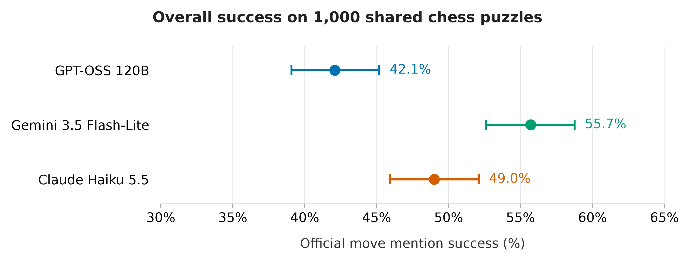
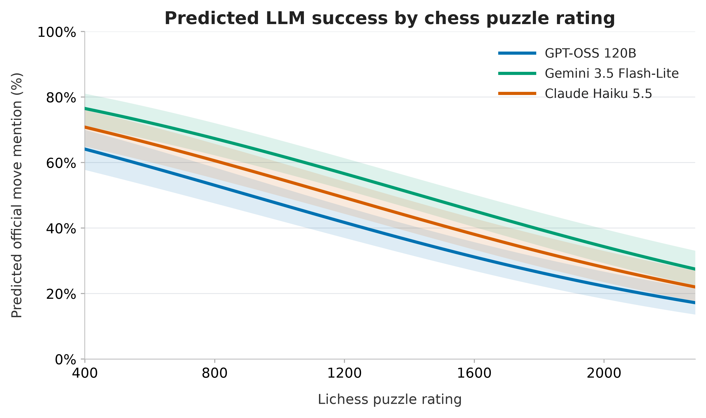
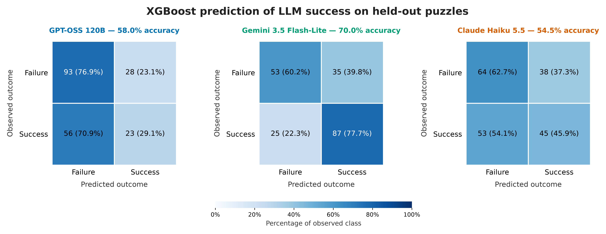
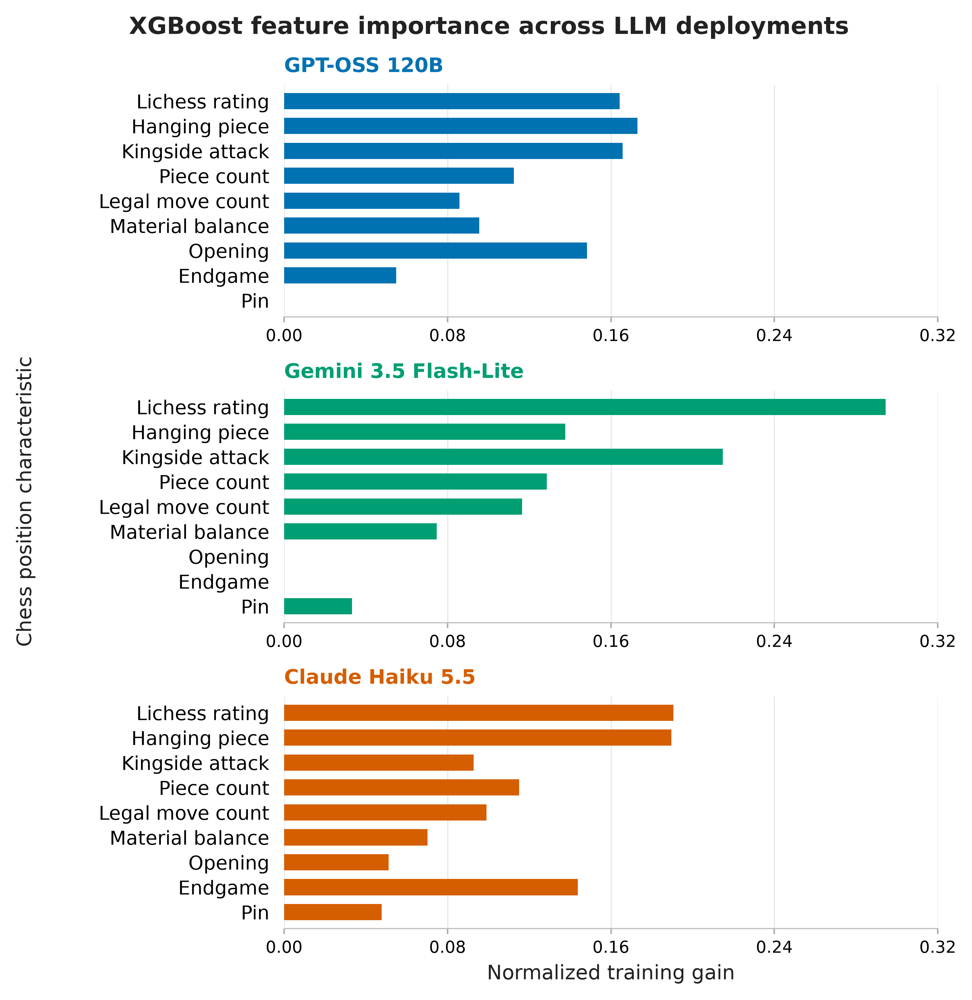

# Human-rated difficulty and assisted one-move chess-puzzle success

Victor Le · DA401 · Final analysis, November 1, 2026

## Abstract

I studied whether human-rated puzzle difficulty and board characteristics relate to language-model success on assisted one-move chess puzzles. Three hosted deployments answered the same 1,000 frozen puzzles, each supplied as a FEN, a piece list and an alphabetical list of legal moves. Under the amended solution-move mention rule, Gemini succeeded on 55.7%, Claude on 49.0% and GPT-OSS on 42.1%. A pooled logistic regression used 3,000 responses, frozen board predictors and deployment identity, with standard errors clustered over 1,000 puzzles. A 500-point increase in rating was associated with an odds ratio of 0.564 (95% CI 0.511–0.624; p=3.61×10⁻²⁹). Separate fixed XGBoost classifiers trained on 800 puzzles and evaluated on 200 held-out puzzles predicted Gemini success with 70.0% accuracy; prediction for the other deployments was weaker. These findings concern assisted solution-move mentions in a rating-balanced sample dominated by mate-in-one tactics. Scoring was amended after results were inspected, and the model ranking depends on the scoring rule.

## Research question and study development

My question is whether human-rated difficulty predicts assisted one-move success, and whether board characteristics provide additional information. Earlier local full-solution and assisted first-move trials motivated the revised task because they produced too few successes for the intended analysis. Those feasibility trials used different samples and prompts and are not pooled into this study or treated as a controlled local-versus-hosted comparison.

The original proposal, literature review and research-design PDFs remain unchanged. The revised protocol, scoring amendment, Claude amendment and dated final three-model plan document the actual study. The final three-model amendment was recorded after completed collection and inspected aggregate/early results, before final fitting and held-out predictive evaluation. The rating hypothesis and fixed feature recipe were inherited from earlier plans; this history is not an original, unchanged preregistration.

## Data and measurement

I used 1,000 unique frozen solver positions, excluding earlier sampled/reserved IDs and solver positions. Rating strata contain 334 low-rated puzzles (≤1157), 333 middle-rated puzzles (1158–1700), and 333 high-rated puzzles (>1700). Every deployment uses the same 800 training and 200 held-out puzzle IDs. The first 100 pilot puzzles and the later 400-puzzle checkpoint are training cases; they remain part of the final sample. Completed answers were retained, including wrong answers.

The deployments are GPT-OSS 120B (`openai/gpt-oss-120b`), Gemini 3.5 Flash-Lite (`gemini-3.5-flash-lite`) and Claude Haiku 5.5 (`claude-haiku-5-5`). Their recorded generation settings are in the original config and Claude amendment. Provider settings and effort labels are not matched compute budgets. Each answer is one recorded response rather than an estimate over repeated stochastic trials.

The input contains FEN, a piece list and all legal moves in alphabetical order. It omits the answer, rating, themes, phase labels, engine evaluations and tools. This is assisted selection from legal moves, not unaided chess move generation or multi-step solving.

The current binary outcome counts the official solution move when it appears as a standalone, board-resolvable UCI or algebraic move in the visible answer, including explanations or alternatives. It does not require that the move be the unique recommendation. Correct visible mentions in truncated answers also count. Hidden reasoning and the supplied input move list are excluded. The identical local scoring rule applies to all deployments. Original strict formatting scores and immutable raw logs are retained.

The final data checks confirm 1,000 unique puzzle IDs and response trial IDs per deployment; completed status; binary strict and tolerant outcomes; the expected returned model; identical frozen FENs, official moves, ordering and split; and matching result/sample/manifest/scoring hashes in the saved collection audits. Final input snapshots and a separate file-hash audit preserve the analyzed state. No new API requests were made for this analysis.

## Analysis methods

The association model is an unpenalized binomial GLM with a logit link, using rating per 500 points, legal-move count per 10, piece count per 10, solver-relative material balance, three training-common theme indicators (pin, kingside attack and hanging piece), phase indicators (endgame and opening; middlegame reference), and Gemini/Claude identity indicators (GPT-OSS reference). There are no interactions. Theme and phase encoding was fixed from training characteristics before responses. Solution length is constant at one and excluded; side to move is descriptive.

The pooled model uses all 3,000 answers and puzzle-clustered covariance over 1,000 puzzles to account for responses to the same positions. Gates passed for class counts, design-matrix rank, convergence, finite estimates/covariance and absence of a perfect-separation warning. I report ordinary 95% intervals and the inherited two-sided rating test. Other coefficients are secondary, with no multiplicity adjustment. These are associations rather than causal effects. The common rating slope is imposed by the fixed additive specification; it does not establish equal slopes across deployments.

For prediction, I fitted one XGBoost classifier per deployment on the fixed 800 training puzzles, using the same frozen features in original count/rating units. XGBoost 3.4.1 used 150 trees, depth 3, learning rate 0.05, minimum child weight 5, L2 regularization 1, full row/column sampling, CPU histogram training and random seed 401. There was no feature search, hyperparameter tuning, early stopping or use of held-out labels in fitting. Native model files and training receipts were saved before test prediction. Predictions and metrics for the fixed 200 test puzzles were cached with hashes for reuse. Classification uses probability ≥0.5. The majority baseline always predicts the training set's majority outcome.

The full-sample regression estimates associations; held-out evaluation measures only prediction of model success. Reporting full-sample success rates does not make them predictive test-set scores. Wilson intervals describe each proportion and do not constitute a paired test of deployment differences.

## Results

### Overall solution-move mention success

| Deployment | Correct / puzzles | Success | Wilson 95% interval |
| --- | --- | --- | --- |
| GPT-OSS 120B | 421/1000 | 42.1% | 39.1%–45.2% |
| Gemini 3.5 Flash-Lite | 557/1000 | 55.7% | 52.6%–58.8% |
| Claude Haiku 5.5 | 490/1000 | 49.0% | 45.9%–52.1% |

Gemini exceeded GPT-OSS by 13.6 percentage points and Claude by 6.7 points on the same sample; Claude exceeded GPT-OSS by 6.9 points. These are observed differences for the recorded deployments and scoring policy.

### Difficulty and adjusted associations

| Deployment | Low (n=334) | Middle (n=333) | High (n=333) |
| --- | --- | --- | --- |
| GPT-OSS 120B | 55.4% | 40.8% | 30.0% |
| Gemini 3.5 Flash-Lite | 74.6% | 58.0% | 34.5% |
| Claude Haiku 5.5 | 62.9% | 48.3% | 35.7% |

Success declined across the frozen rating bands for every deployment. The pooled regression estimates are:

| Predictor | Adjusted odds ratio | 95% interval | Two-sided p |
| --- | --- | --- | --- |
| Rating (+500 points) | 0.564 | 0.511–0.624 | 3.61e-29 |
| Legal moves (+10) | 0.996 | 0.877–1.131 | 0.948 |
| Pieces (+10) | 1.109 | 0.851–1.446 | 0.443 |
| Material balance (+1 pawn-equivalent) | 1.010 | 0.979–1.043 | 0.526 |
| Pin tag | 0.802 | 0.544–1.181 | 0.263 |
| Kingside attack tag | 1.439 | 1.076–1.925 | 0.014 |
| Hanging piece tag | 2.937 | 1.941–4.445 | 3.42e-07 |
| Endgame vs middlegame | 1.194 | 0.892–1.600 | 0.234 |
| Opening vs middlegame | 0.703 | 0.494–1.001 | 0.0503 |
| Gemini vs GPT-OSS | 1.823 | 1.528–2.175 | 2.49e-11 |
| Claude vs GPT-OSS | 1.358 | 1.147–1.608 | 0.000371 |

Holding the included predictors and deployment identity fixed, a 500-point rating increase corresponds to approximately 43.6% lower odds of success. This is an odds change, not a 43.6 percentage-point decrease in probability. Hanging-piece and kingside-attack tags show positive secondary associations, while the ordinary intervals for legal moves, piece count, material balance, pin and phase overlap an odds ratio of one. This does not prove those features have no relationship to success. Gemini and Claude have higher adjusted odds than GPT-OSS under the amended outcome.

The curves hold numeric features at training medians, theme indicators at zero and phase at middlegame. They are conditional model summaries with pointwise, puzzle-clustered intervals, not observed band means or population averages.

### Held-out prediction of LLM success

| Deployment | Accuracy (95% interval) | Balanced accuracy | ROC AUC | Brier | Majority baseline |
| --- | --- | --- | --- | --- | --- |
| GPT-OSS 120B | 58.0% (51.1%–64.6%) | 0.530 | 0.599 | 0.242 | 60.5% |
| Gemini 3.5 Flash-Lite | 70.0% (63.3%–75.9%) | 0.690 | 0.714 | 0.214 | 56.0% |
| Claude Haiku 5.5 | 54.5% (47.6%–61.3%) | 0.543 | 0.598 | 0.247 | 51.0% |

These percentages measure the classifier's ability to predict whether an LLM answer succeeds. They are distinct from the LLM's own chess-puzzle success rate. On the 200 test puzzles, the LLMs themselves succeeded on 79/200 for GPT-OSS, 112/200 for Gemini and 98/200 for Claude.

Gemini's classifier exceeded its majority baseline by 14.0 percentage points, with ROC AUC 0.714. GPT-OSS's classifier scored 2.5 points below its baseline, despite ROC AUC above 0.5. Claude's classifier exceeded its baseline by 3.5 points, with ROC AUC 0.598. I do not claim statistical superiority over the baselines from these descriptive differences. The single 200-puzzle holdout gives imprecise performance estimates, especially for small improvements. Lower Brier scores indicate better probability predictions; these are raw scores, not comparisons against a probability baseline.

The confusion counts use failure=0 and success=1:

| Deployment | True failure | False success | False failure | True success |
| --- | --- | --- | --- | --- |
| GPT-OSS 120B | 93 | 28 | 56 | 23 |
| Gemini 3.5 Flash-Lite | 53 | 35 | 25 | 87 |
| Claude Haiku 5.5 | 64 | 38 | 53 | 45 |

Rating has the largest training gain importance for Gemini and Claude; hanging-piece and kingside-attack indicators also contribute. Training gain describes how the fitted ensemble used features. It is not causal evidence or proof that a feature improves held-out performance. No final models were changed in response to the test results.

### Dependence on scoring policy

| Deployment | Strict correct | Tolerant correct | Increase | Answers mentioning multiple legal moves |
| --- | --- | --- | --- | --- |
| GPT-OSS 120B | 418/1000 | 421/1000 | 3 | 0 |
| Gemini 3.5 Flash-Lite | 545/1000 | 557/1000 | 12 | 0 |
| Claude Haiku 5.5 | 286/1000 | 490/1000 | 204 | 5 |

The strict ordering is Gemini > GPT-OSS > Claude; the tolerant ordering is Gemini > Claude > GPT-OSS. Claude's 20.4 percentage-point increase is much larger than the other deployments' increases. Strict formatting failure and absence of a correct move therefore lead to different comparisons. Five Claude responses contain multiple recognizable legal moves. The tolerant rule remains any official-move mention, including alternatives, quotation or negation; it cannot guarantee a unique selected move. This table is a descriptive sensitivity comparison, not a second tuned analysis.

## Discussion and limitations

Human-rated difficulty is strongly associated with lower assisted solution-move mention success in this sample. Frozen board features support useful predictive discrimination for Gemini, but the limited held-out performance for GPT-OSS and Claude shows that fitting feature relationships does not guarantee useful individual-outcome prediction. Additional controlled studies would be needed to determine why features or deployment differences arise.

The main scope limitation is that 979 of 1,000 puzzles carry the mate-in-one tag. The sample is rating-balanced rather than a representative draw of all chess puzzles. Its findings mainly concern short mating tactics under legal-move assistance, not general strategic ability, human first-move accuracy or multi-step play. The human rating is used as a dataset difficulty measure; it is not measured human performance on these trials.

The task and analysis evolved after exploratory results. Claude was added later, tolerant scoring followed inspected strict results (including completed Gemini collection), and the final three-model extension followed completed collection and early analyses. Those changes are disclosed and weaken claims of a wholly confirmatory study. The fixed holdout was not used to tune predictive models, but the overall workflow should not be described as blind to every test answer: aggregate scores and the scoring amendment existed before final evaluation.

Deployment comparisons combine model, provider and generation-setting differences. One response per puzzle does not measure run-to-run variability. Clustered covariance addresses within-puzzle dependence across deployments, but does not establish independence between similar puzzles or remove selection bias. Coefficient intervals are model-based, and secondary comparisons are unadjusted. Dataset exposure or memorization was not measured.

## Reproducibility and artifacts

Run `notebooks/06_final_analysis.ipynb` in the pinned Python environment with the local ignored study data available. It verifies source audits, original manifest bindings, the amended plan and notebook code hash; reuses frozen input snapshots, XGBoost models and cached held-out predictions; and makes no provider requests. `scripts/build_final_report.py` rebuilds this report from the analysis artifacts.

The original final plan is retained at `experiments/one_move_v1/final_analysis_plan.json`; its three-model extension and code binding are adjacent. Frozen inputs, file audits, regression coefficients, model files, training receipts and cached test results are in `data/analysis/one_move_v1/final/` (ignored by Git). Shareable CSV tables are copied into `writing/final_tables/`; figures are in `figures/one_move_v1/final/`. Early checkpoints and original PDFs remain historical records. No publication, commit or push is part of this analysis.
